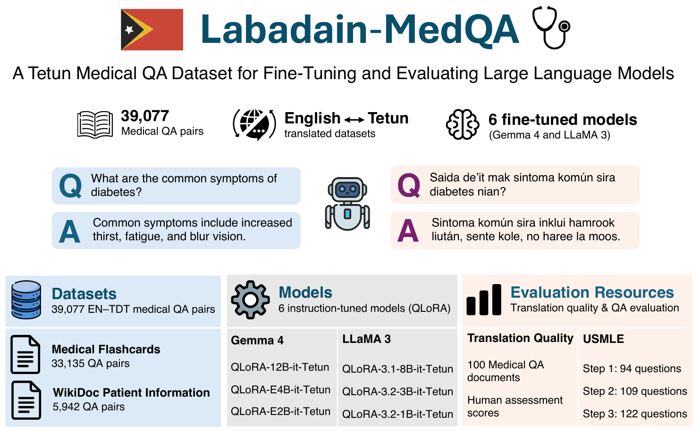

# Overview
This repository documents the prompts and supporting reference files used to construct and evaluate Labadain-MedQA, a collection of datasets, models, and evaluation resources for medical question answering in Tetun. The published datasets and models are available under the [`labadain`](https://huggingface.co/labadain) account on Hugging Face.

# Datasets

The translated MedAlpaca datasets contain 39,077 English–Tetun medical question-answer pairs used for model fine-tuning.

- [Labadain-MedQA-MedAlpaca-Medical-Flashcards-English-Tetun](https://huggingface.co/datasets/labadain/Labadain-MedQA-MedAlpaca-Medical-Flashcards-English-Tetun) — 33,135 QA pairs covering biomedical and clinical knowledge.
- [Labadain-MedQA-MeadAlpaca-WikiDoc-Patient-Information-English-Tetun](https://huggingface.co/datasets/labadain/Labadain-MedQA-MeadAlpaca-WikiDoc-Patient-Information-English-Tetun) — 5,942 QA pairs covering medical conditions, symptoms, treatments, and patient information.

# Evaluation Resources

The evaluation resources support translation quality assessment and downstream model evaluation.

## Translation Quality Evaluation

- [Labadain-MedQA-Sample-for-Evaluation-English-Tetun](https://huggingface.co/datasets/labadain/Labadain-MedQA-Sample-for-Evaluation-English-Tetun) — 100 randomly selected medical QA documents from 50 sampled pairs, including English originals, human reference translations, and LLM-generated translations.
- [Labadain-MedQA-Human-Assessment-Scores-English-Tetun](https://huggingface.co/datasets/labadain/Labadain-MedQA-Human-Assessment-Scores-English-Tetun) — Human evaluation scores for medical accuracy and Tetun fluency, assessed by two healthcare professionals.

## Downstream Model Evaluation

Three English–Tetun USMLE datasets contain 325 multiple-choice questions with answer options and correct answers.

- [Labadain-MedQA-USMLE-Step-1-English-Tetun](https://huggingface.co/datasets/labadain/Labadain-MedQA-USMLE-Step-1-English-Tetun) — 94 questions covering foundational medical sciences.
- [Labadain-MedQA-USMLE-Step-2-English-Tetun](https://huggingface.co/datasets/labadain/Labadain-MedQA-USMLE-Step-2-English-Tetun) — 109 questions focusing on clinical knowledge and its application.
- [Labadain-MedQA-USMLE-Step-3-English-Tetun](https://huggingface.co/datasets/labadain/Labadain-MedQA-USMLE-Step-3-English-Tetun) — 122 questions focusing on clinical decision-making and patient management.

See all [Labadain-MedQA datasets](https://huggingface.co/labadain/datasets?search=MedQA).

# Models

Six models from the *Gemma 4* and *Llama 3* families were fine-tuned on the translated MedAlpaca datasets using QLoRA. The models are published as PEFT adapters under the `Labadain-MedQA` prefix on Hugging Face.

## Gemma 4

- [Labadain-MedQA-QLoRA-Gemma-4-12B-it-Tetun](https://huggingface.co/labadain/Labadain-MedQA-QLoRA-Gemma-4-12B-it-Tetun) — Based on `unsloth/gemma-4-12b-it`.
- [Labadain-MedQA-QLoRA-Gemma-4-E4B-it-Tetun](https://huggingface.co/labadain/Labadain-MedQA-QLoRA-Gemma-4-E4B-it-Tetun) — Based on `unsloth/gemma-4-E4B-it`.
- [Labadain-MedQA-QLoRA-Gemma-4-E2B-it-Tetun](https://huggingface.co/labadain/Labadain-MedQA-QLoRA-Gemma-4-E2B-it-Tetun) — Based on `unsloth/gemma-4-E2B-it`.

## Llama 3

- [Labadain-MedQA-QLoRA-LLaMA-3.1-8B-it-Tetun](https://huggingface.co/labadain/Labadain-MedQA-QLoRA-LLaMA-3.1-8B-it-Tetun) — Based on `unsloth/Meta-Llama-3.1-8B-Instruct`.
- [Labadain-MedQA-QLoRA-LLaMA-3.2-3B-it-Tetun](https://huggingface.co/labadain/Labadain-MedQA-QLoRA-LLaMA-3.2-3B-it-Tetun) — Based on `unsloth/Llama-3.2-3B-Instruct`.
- [Labadain-MedQA-QLoRA-LLaMA-3.2-1B-it-Tetun](https://huggingface.co/labadain/Labadain-MedQA-QLoRA-LLaMA-3.2-1B-it-Tetun) — Based on `unsloth/Llama-3.2-1B-Instruct`.

See all [Labadain-MedQA models](https://huggingface.co/labadain/models?search=MedQA).

# Prompts

The following prompts and supporting reference files were used in the resource construction and evaluation pipeline:

- [English-to-Tetun translation prompt](prompts/en-tdt-translation-prompt.md) — Instructions for an LLM to translate English text into Tetun using provided translation examples and return only the translated text.
- [English-to-Tetun translation examples](prompts/en-tdt-translation-examples.md) – Reference examples illustrating English-to-Tetun translation following standard Tetun orthography.
- [Tetun orthographic revision prompt](prompts/tetun-revision-prompt.md) —  Instructions for an LLM to revise Tetun text according to official INL orthography, Portuguese loanword adaptation rules, and curated vocabulary.
- [Tetun orthographic rules](prompts/pt-loanwords-to-tetun-rules.md) — Reference guidelines for adapting Portuguese-derived loanwords to standard Tetun orthography.
- [Curated Tetun word list](prompts/tetun-curated-word-list.md) — A multilingual vocabulary reference mapping English, Indonesian, and Portuguese terms to preferred Tetun equivalents.
- [Multiple-choice question evaluation prompt](prompts/multiple-selection-prompt.md) — Instructions for an LLM to answer medical multiple-choice questions by selecting the most correct option.
