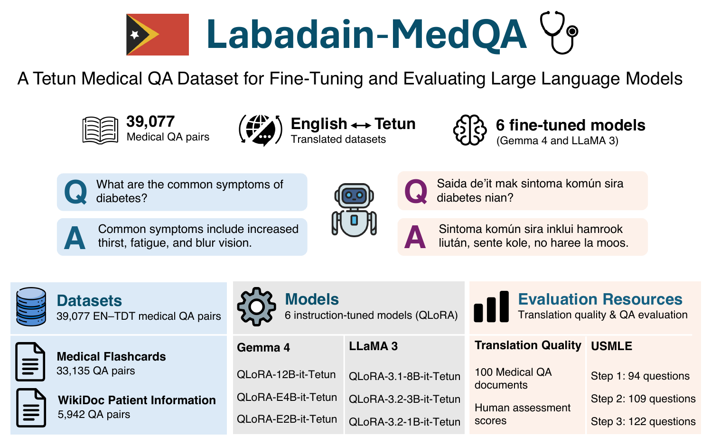

# Labadain-MedQA

Labadain-MedQA is a collection of datasets, models, and evaluation resources for medical question answering (QA) in Tetun, a low-resource language spoken in Timor-Leste. It comprises English–Tetun medical QA datasets, QLoRA fine-tuned language models, translation-quality evaluation resources, and translated USMLE evaluation sets.

The resources support:

- Fine-tuning language models for Tetun medical QA.
- Evaluating English-to-Tetun medical translation quality.
- Evaluating model performance on translated medical multiple-choice questions.
- Research on cross-lingual medical knowledge transfer and information access in Tetun.

This repository provides the prompts and supporting reference files used in the construction and evaluation of Labadain-MedQA. The published datasets and models are available under the [`labadain` account on Hugging Face](https://huggingface.co/labadain).

## Resource Overview

| Resource | Contents |
| --- | --- |
| Training datasets | 39,077 English–Tetun medical QA pairs from two datasets |
| Fine-tuned models | Six QLoRA/PEFT adapters from the Gemma 4 and Llama 3 families |
| Translation evaluation | 100 medical QA documents and human assessment scores |
| Downstream evaluation | 325 translated USMLE multiple-choice questions across three collections |
| Construction and evaluation materials | Translation prompts, orthographic rules, vocabulary references, and evaluation prompts |

## Resource Construction

The medical QA training datasets were derived from the MedAlpaca Medical Flashcards and WikiDoc Patient Information collections. The English source content was translated into Tetun using Gemini 2.5 Flash through a two-stage process:

1. **English-to-Tetun translation:** Medical QA content was translated using a prompt containing English–Tetun examples.
2. **Tetun orthographic revision:** The translated text was revised using a separate prompt guided by official Instituto Nacional de Linguística (INL) orthography, Portuguese-to-Tetun spelling adaptation rules, and curated vocabulary.

Both prompts were iteratively refined during development. The final prompts and supporting reference files are available in the [Prompts and Reference Files](#prompts-and-reference-files) section.

Translation quality was evaluated using human reference translations, automatic translation metrics, and assessments by two native Tetun-speaking healthcare professionals.

## Datasets

### Medical QA Training Data

The translated MedAlpaca datasets contain 39,077 English–Tetun medical QA pairs, of which only the Tetun questions and answers were used for model fine-tuning.

- [Medical Flashcards](https://huggingface.co/datasets/labadain/Labadain-MedQA-MedAlpaca-Medical-Flashcards-English-Tetun): 33,135 QA pairs covering biomedical and clinical knowledge.
- [WikiDoc Patient Information](https://huggingface.co/datasets/labadain/Labadain-MedQA-MedAlpaca-WikiDoc-Patient-Information-English-Tetun): 5,942 QA pairs covering medical conditions, symptoms, treatments, and patient information.

#### Data Structure

Each QA pair contains four fields:

| Field | Description |
| --- | --- |
| `input_en` | Question in English |
| `input_tdt` | Question in Tetun |
| `output_en` | Answer in English |
| `output_tdt` | Answer in Tetun |

The Tetun fields support instruction fine-tuning, while the parallel English–Tetun data are intended to support future research on cross-lingual medical QA and translation.

#### Loading the Datasets

The datasets can be loaded using the Hugging Face `datasets` library:

```bash
pip install datasets
```

```python
from datasets import load_dataset

flashcards = load_dataset(
    "labadain/Labadain-MedQA-MedAlpaca-Medical-Flashcards-English-Tetun",
    split="train"
)

wikidoc = load_dataset(
    "labadain/Labadain-MedQA-MedAlpaca-WikiDoc-Patient-Information-English-Tetun",
    split="train"
)

print("Medical Flashcards:", len(flashcards))
print("WikiDoc Patient Information:", len(wikidoc))

# Display an English–Tetun QA pair from each dataset
print(flashcards[0])
print(wikidoc[0])
```

The Tetun question and answer fields were used to construct instruction–response examples for model fine-tuning. The training format depends on the selected model and its chat template.

## Evaluation Resources

The evaluation resources support translation quality assessment and downstream model evaluation.

### Translation Quality Evaluation

Translation quality was evaluated on 100 randomly selected medical QA documents (50 question-answer pairs), using human reference translations and assessments by two native Tetun-speaking healthcare professionals.

- [Translation Evaluation Sample](https://huggingface.co/datasets/labadain/Labadain-MedQA-Sample-for-Evaluation-English-Tetun): Contains English originals, human reference translations, and LLM-generated translations for 100 medical QA documents.
- [Human Translation Assessment Scores](https://huggingface.co/datasets/labadain/Labadain-MedQA-Human-Assessment-Scores-English-Tetun): Contains human evaluation scores for medical accuracy and Tetun fluency.

The translation sample supports automatic metric computation against human references. The human assessment scores support analysis of medical accuracy, Tetun fluency, and inter-annotator agreement.

### Downstream Model Evaluation

Three English–Tetun USMLE datasets provide 325 multiple-choice questions for evaluating language models on medical knowledge and reasoning tasks in Tetun.

| Dataset | Questions | Coverage |
| --- | ---: | --- |
| [USMLE Step 1](https://huggingface.co/datasets/labadain/Labadain-MedQA-USMLE-Step-1-English-Tetun) | 94 | Foundational medical sciences |
| [USMLE Step 2](https://huggingface.co/datasets/labadain/Labadain-MedQA-USMLE-Step-2-English-Tetun) | 109 | Clinical knowledge and its application |
| [USMLE Step 3](https://huggingface.co/datasets/labadain/Labadain-MedQA-USMLE-Step-3-English-Tetun) | 122 | Clinical decision-making and patient management |
| **Total** | **325** | |

Each dataset contains English and Tetun questions, answer options, and corresponding correct answers.

The datasets support accuracy-based evaluation using a multiple-choice prompt that instructs models to select one answer option. The evaluation prompt is available in the [Prompts and Reference Files](#prompts-and-reference-files) section.

These datasets are intended for evaluation rather than model fine-tuning, regardless of the split names used by the Hugging Face dataset viewer.

See all [Labadain-MedQA datasets](https://huggingface.co/labadain/datasets?search=MedQA).

## Models

Six instruction-tuned models from the Gemma 4 and Llama 3 families were adapted for Tetun medical QA using QLoRA on the translated MedAlpaca training datasets.

The published models are **PEFT adapters**, not standalone copies of the base models. Each adapter must be loaded with its compatible base model, as documented in the respective Hugging Face model card.

### Gemma 4

| Model | USMLE Macro-Average Accuracy |
| --- | ---: |
| [Gemma 4 12B QLoRA](https://huggingface.co/labadain/Labadain-MedQA-QLoRA-Gemma-4-12B-it-Tetun) | 48.64% |
| [Gemma 4 E4B QLoRA](https://huggingface.co/labadain/Labadain-MedQA-QLoRA-Gemma-4-E4B-it-Tetun) | 45.95% |
| [Gemma 4 E2B QLoRA](https://huggingface.co/labadain/Labadain-MedQA-QLoRA-Gemma-4-E2B-it-Tetun) | 26.25% |

### Llama 3

| Model | USMLE Macro-Average Accuracy |
| --- | ---: |
| [Llama 3.1 8B QLoRA](https://huggingface.co/labadain/Labadain-MedQA-QLoRA-LLaMA-3.1-8B-it-Tetun) | 21.75% |
| [Llama 3.2 3B QLoRA](https://huggingface.co/labadain/Labadain-MedQA-QLoRA-LLaMA-3.2-3B-it-Tetun) | 20.41% |
| [Llama 3.2 1B QLoRA](https://huggingface.co/labadain/Labadain-MedQA-QLoRA-LLaMA-3.2-1B-it-Tetun) | 17.61% |

The reported results correspond to the QLoRA evaluation configurations documented in the model cards, including the 4-bit inference configuration for the Gemma models. Macro-average accuracy is calculated as the unweighted mean of the accuracies across the three USMLE evaluation sets. Results for alternative precision or adapter-merging configurations may differ.

Each model card provides additional information about its base checkpoint, fine-tuning approach, evaluation results, and model-loading instructions.

See all [Labadain-MedQA models](https://huggingface.co/labadain/models?search=MedQA).

## Prompts and Reference Files

The following prompts and supporting reference files document the resource construction and evaluation pipeline.

### Translation and Orthographic Revision

- [English-to-Tetun translation prompt](prompts/en-tdt-translation-prompt.md): Instructions for translating English text into Tetun while preserving meaning, structure, formatting, names, and measurements.
- [English-to-Tetun translation examples](prompts/en-tdt-translation-examples.md): Reference examples used to guide English-to-Tetun translation.
- [Tetun orthographic revision prompt](prompts/tetun-revision-prompt.md): Instructions for revising Tetun text according to official Tetun orthography, Portuguese loanword adaptation rules, and curated vocabulary.
- [Tetun orthographic rules](prompts/pt-loanwords-to-tetun-rules.md): Reference guidelines for Tetun spelling, accented vowels, hyphenation, loanword adaptation, and word-final stress.
- [Curated Tetun word list](prompts/tetun-curated-word-list.md): Multilingual vocabulary mappings from English, Indonesian, and Portuguese to preferred Tetun equivalents.

### Model Evaluation

- [Multiple-choice question evaluation prompt](prompts/multiple-selection-prompt.md): Instructions for selecting the most appropriate answer to a medical multiple-choice question and returning one option label.

Additional [annotation tools and guidelines](annotation-tools-and-guidelines/) are provided in this repository.

## Intended Use and Limitations

Labadain-MedQA is intended for research on Tetun medical QA, medical information access, cross-lingual knowledge transfer, and the evaluation of language models in low-resource settings.

Users should consider the following limitations:

- The training datasets were generated through automatic translation and may contain medical, linguistic, or orthographic errors.
- Translation quality was evaluated using a sample of 100 documents, which may not capture all errors in the complete datasets.
- The translated USMLE evaluation sets measure performance on medical multiple-choice questions and do not establish clinical reliability.
- The fine-tuned models may produce incorrect or misleading medical information.

**These resources are intended for research and are not validated for clinical diagnosis, treatment decisions, or unsupervised patient care.**

## Availability and Licensing

The datasets and models are publicly available under the [Labadain account on Hugging Face](https://huggingface.co/labadain). The prompts and supporting reference files are maintained in this GitHub repository.

All the resources are released under the [Creative Commons Attribution-ShareAlike 4.0 International License](LICENSE).

The datasets are derived from existing medical resources, and the fine-tuned models depend on third-party base checkpoints. Users should consult the individual dataset and model cards for applicable source attribution, licensing information, and usage restrictions. The repository license does not supersede the terms governing upstream datasets or base models.

## Citation

If you use Labadain-MedQA, please acknowledge the resource and its original data sources. 
The citation for the associated Labadain-MedQA research paper will be added when its publication details are available.

## Feedback and Contributions

Researchers are welcome to report data errors, translation issues, documentation problems, or other findings through the [GitHub Issues](https://github.com/labadain/labadain-medqa/issues) page.